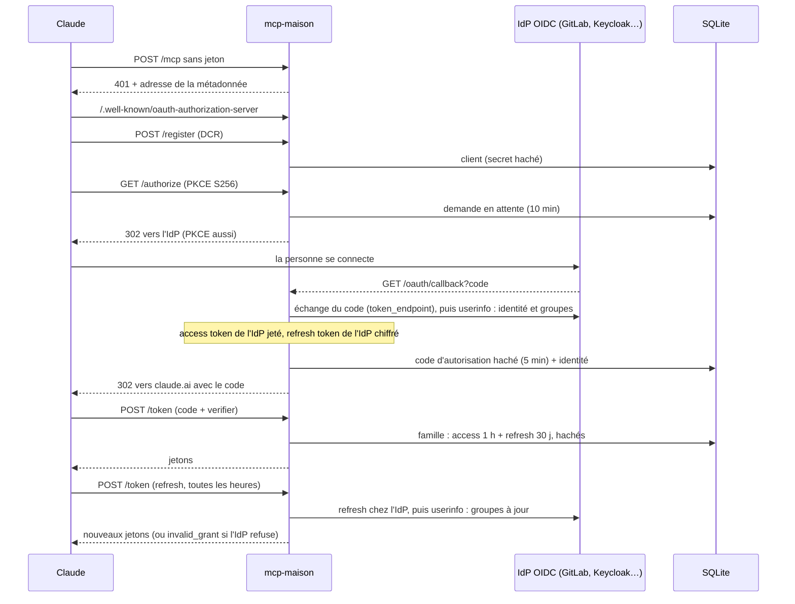
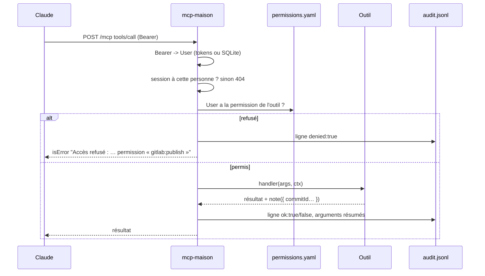

# Architecture

mcp-maison est un serveur MCP distant (transport Streamable HTTP) que l'on branche dans Claude.
Il répond à trois questions, chacune dans son dossier :

| Question | Dossier | Ce qu'il fait |
| --- | --- | --- |
| Qui appelle ? | `src/identity/` | Serveur OAuth 2.1 qui délègue la connexion à un IdP OIDC (`oauth/`) ; jetons de dev hors production |
| Qui peut quoi ? | `src/authorization/` | Interface `Authorizer`, implémentée par `permissions.yaml` (relu à chaud) |
| Qu'a-t-on fait ? | `src/audit/` | Journal JSON Lines, une ligne par appel, refus compris |

Les outils vivent dans `src/tools/<groupe>/`. Un groupe = une intégration (core, gitlab).

## Les fichiers

```
src/server.ts             point d'entrée : config, groupes, droits, écoute
src/app.ts                HTTP : /health, /audit, /mcp, montage OAuth
src/mcp-sessions.ts       sessions MCP, chacune liée à la personne qui l'a ouverte
src/config.ts             variables du cœur validées (zod)
src/identity/             user.ts (User), dev-tokens.ts, secrets.ts, oauth/ (store SQLite, OIDC)
src/authorization/        authorizer.ts (interface), rules.ts, permissions-file.ts
src/audit/log.ts          écriture et lecture du journal
src/tools/types.ts        contrat Tool, ToolGroup, ToolContext
src/tools/registry.ts     charge les groupes de TOOL_GROUPS
src/tools/runner.ts       droit -> exécution -> journal
src/tools/core|gitlab/
```

## Connexion (OIDC)



Avec `AUTH_DEV_TOKENS` (hors production), rien de tout ça : le Bearer est cherché par son empreinte.

## Appel d'outil et audit



Le journal ne contient jamais le contenu des fichiers ni un secret : chaque outil résume ses arguments
(`auditArgs`), sinon les chaînes longues sont réduites à leur taille.

## Les choix et leur coût

| Choix | Ce qu'il rapporte | Ce qu'il coûte |
| --- | --- | --- |
| SQLite pour l'état OAuth | Un redémarrage ne déconnecte personne | Un seul réplica (fichier local) ; sauvegarde à prévoir |
| Identité relue à chaque refresh | Groupes et blocages de l'IdP pris en compte dans l'heure | Refresh token de l'IdP gardé (chiffré) ; IdP injoignable = reconnexion |
| Outils visibles même sans droit | Le refus est explicite et journalisé | Claude voit des outils qu'il ne pourra pas appeler |
| Groupe mal configuré ignoré | Une intégration en panne ne coupe pas les autres | Il faut lire l'avertissement au démarrage |
