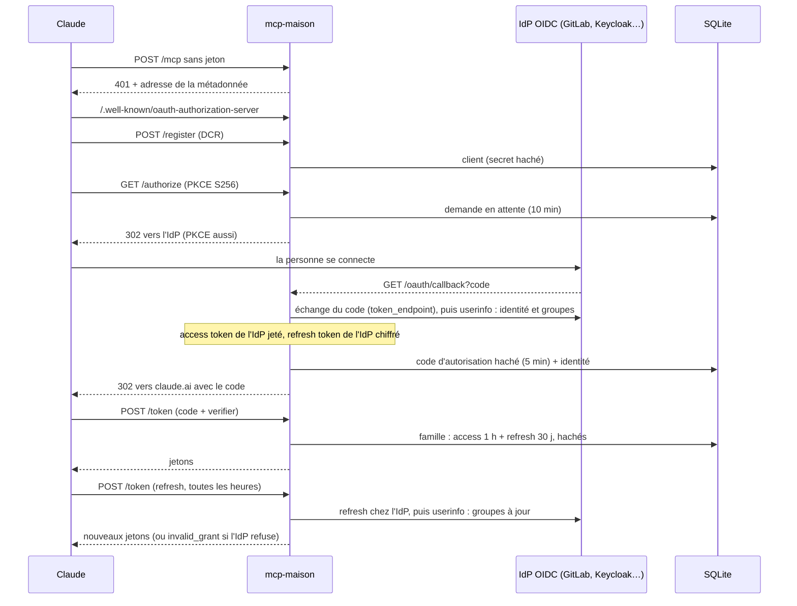
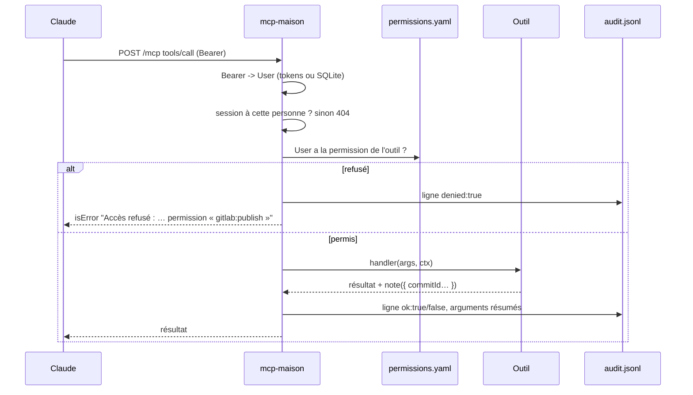

# Architecture

mcp-maison est un serveur MCP distant (transport Streamable HTTP) que l'on branche dans Claude.
Il répond à trois questions, chacune dans son dossier :

| Question | Dossier | Ce qu'il fait |
| --- | --- | --- |
| Qui appelle ? | `src/identity/` | Serveur OAuth 2.1 qui délègue la connexion à un IdP OIDC (`oauth/`) ; jetons de dev hors production |
| Qui peut quoi ? | `src/authorization/` | Interface `Authorizer`, implémentée par `permissions.yaml` (relu à chaud) |
| Qu'a-t-on fait ? | `src/audit/` | Journal JSON Lines, une ligne par appel, refus compris |

Les outils vivent dans `src/tools/<groupe>/`. Un groupe = une intégration (core, gitlab, opencloud).

## Les fichiers

```
src/main.ts                    le processus : createApp, écoute, arrêt propre, erreurs de démarrage
src/app.ts                     l'assemblage : config, outils, droits, journal, routes /health /audit /mcp
src/config.ts                  variables du cœur, validées (zod)
src/mcp-sessions.ts            sessions MCP, liées à leur personne ; 500 au plus, 20 par personne (la plus ancienne cède)
src/identity/
  user.ts                      User, et comment le retrouver dans une requête
  dev-tokens.ts                AUTH_DEV_TOKENS et le vérificateur Bearer
  secrets.ts                   empreintes, secrets aléatoires, chiffrement
  oauth/routes.ts              montage du serveur d'autorisation et de /oauth/callback
  oauth/authorization-server.ts  OAuth 2.1 pour Claude : jetons, rotation, révocation
  oauth/sign-in-flow.ts        /authorize -> IdP -> /oauth/callback -> code pour Claude
  oauth/redirect-allowlist.ts  où un code peut être renvoyé (OAUTH_REDIRECT_ALLOWLIST)
  oauth/idp-gateway.ts         ce qu'on demande à l'IdP : connexion, renouvellement, comptes autorisés
  oauth/oidc.ts                client OIDC générique : découverte, token_endpoint, userinfo
  oauth/idp-http.ts            appels à l'IdP bornés à 10 s ; « refuse » ou « ne répond pas »
  oauth/clients.ts             clients DCR et vérification de leur secret
  oauth/database.ts            ouverture SQLite et application des migrations
  oauth/migrations.ts          migrations numérotées du schéma (table schema_version)
  oauth/store.ts               lectures et écritures de l'état OAuth
src/authorization/
  authorizer.ts                l'interface Authorizer, seule connue du reste du code
  rules.ts                     format de permissions.yaml et calcul des droits
  permissions-file.ts          l'Authorizer qui lit (et relit) permissions.yaml
src/audit/log.ts, routes.ts    le journal, et GET /audit
src/version.ts                 VERSION, écrit depuis package.json au build (scripts/version.mjs) ; /health
src/tools/types.ts             contrat Tool, ToolGroup, ToolContext, defineGroupConfig
src/tools/registry.ts          charge les groupes de TOOL_GROUPS
src/tools/runner.ts            droit -> exécution -> journal
src/tools/downstream.ts        en-têtes d'identité vers un service aval (X-MCP-Maison-User)
src/tools/slug.ts              SLUG_PATTERN, la seule définition d'un slug
src/tools/gitlab/files.ts      chemins et extensions acceptés à la publication
src/tools/opencloud/           client REST d'openCloud (jeton, délai, Retry-After) et ses lectures filtrées
src/tools/core|gitlab|opencloud/
```

## Connexion (OIDC)



Avec `AUTH_DEV_TOKENS` (hors production), rien de tout ça : le Bearer est cherché par son empreinte.

## Appel d'outil et audit



Le journal ne contient jamais le contenu des fichiers ni un secret : chaque outil résume ses arguments
(`auditArgs`), sinon les chaînes longues sont réduites à leur taille.

## Les choix et leur coût

| Choix | Ce qu'il rapporte | Ce qu'il coûte |
| --- | --- | --- |
| SQLite pour l'état OAuth | Un redémarrage ne déconnecte personne | Un seul réplica (fichier local) ; sauvegarde à prévoir |
| Identité relue à chaque refresh | Groupes et blocages de l'IdP pris en compte dans l'heure | Refresh token de l'IdP gardé (chiffré) ; IdP en panne = pas de refresh tant qu'il ne répond pas |
| Outils visibles même sans droit | Le refus est explicite et journalisé | Claude voit des outils qu'il ne pourra pas appeler |
| Groupe mal configuré ignoré | Une intégration en panne ne coupe pas les autres | Il faut lire l'avertissement au démarrage |
